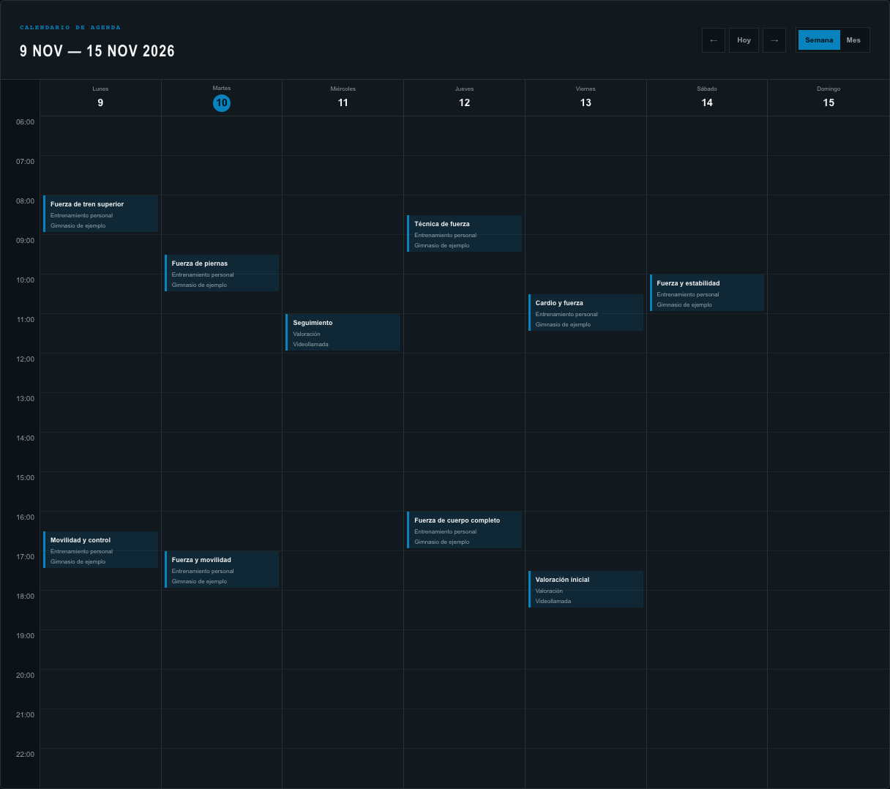
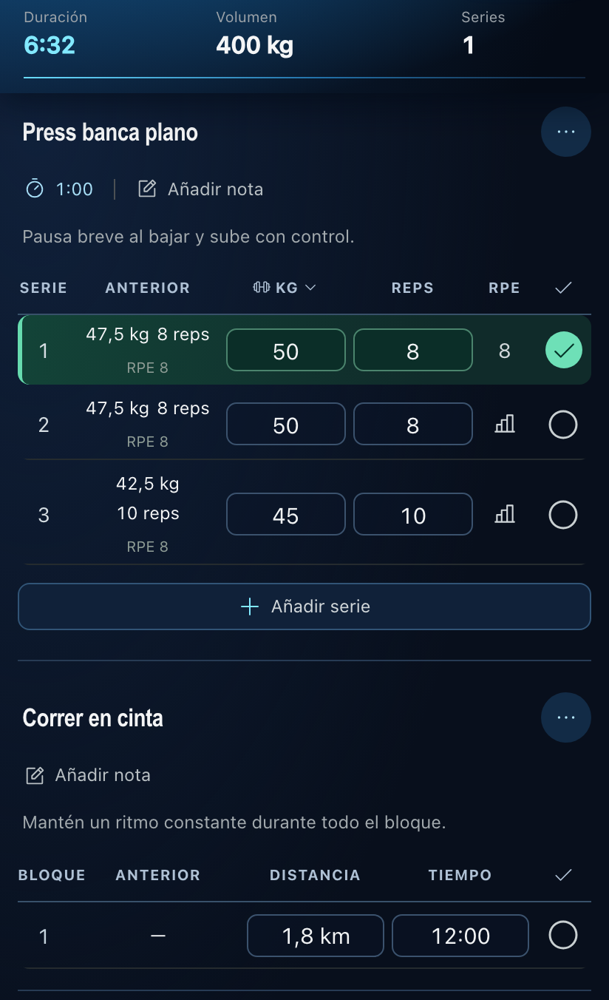
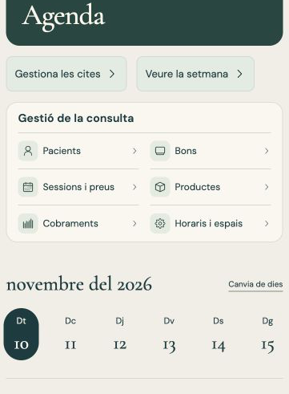
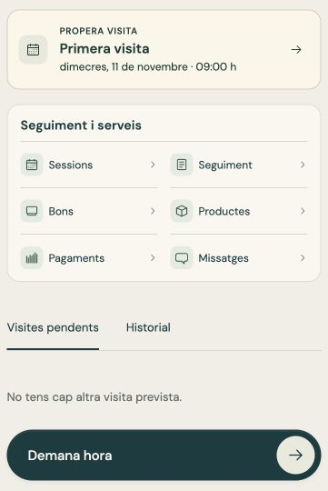
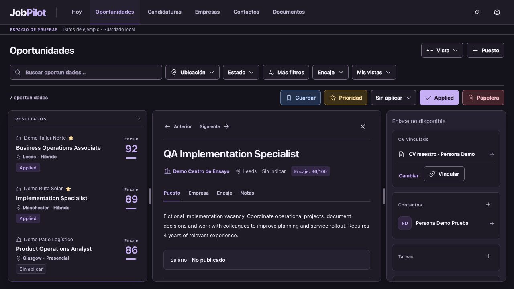
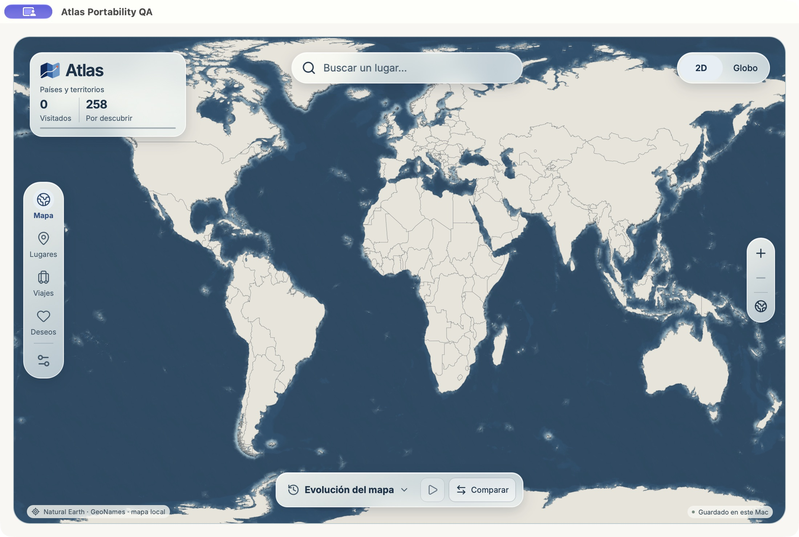

# Arnau Reig Codina · Project portfolio

I like taking a workflow people already use and making it easier to get through. Across these projects, I define what the product needs to do, make decisions about how it should work, and use AI-assisted development to build and test the idea. The screenshots use sample data or an empty test profile.

## 1. énergie Fitness · Multi-gym fitness platform

**What I wanted to solve.** I started with a booking and coaching workflow for one personal trainer. As the prototype grew, I defined how members, trainers and centre managers would work together and what each role could see and do at each centre.

**How it works.** A member can follow a routine and log their sets, book or cancel a personal training session, and message their gym team in a shared conversation. Try the demo from the member’s side, then switch roles to see how the same workflow looks to staff.

**Where it stands.** I’m preparing the platform for a first pilot. The demo uses synthetic data.

[Explore the énergie Fitness demo](https://energie-fitness-demo.portalnow.workers.dev/)

## 2. Marcelo · Personal training platform

**What I wanted to solve.** Scheduling a session and following a training plan are parts of the same service. I worked with a personal trainer to bring bookings, client access and training programmes into one place.

**How it works.** The trainer can use a weekly calendar to see appointments. In the separate mobile training view, a client can see what they lifted last time, record weights and repetitions for strength exercises, and log time and distance for cardio. I worked with the trainer to decide what should be easy to reach on each side, from checking the week ahead to recording a set during a session.

| Weekly schedule | Mobile workout log |
| --- | --- |
|  |  |

*The schedule and workout log shown in a test environment with fictitious data.*

## 3. Physiotherapy booking and follow-up prototype

**What I wanted to solve.** An independent practice needs to handle appointments and follow-up while giving patients a clear view of what happens next. I helped shape a prototype around those two needs.

**How it works.** I defined how patients book and reschedule appointments and how the patient and practitioner each view follow-up. The patient can focus on their next visit and progress, while the practitioner has a separate view for managing the diary and reviewing follow-up.

| Practitioner’s schedule | Patient’s next appointment |
| --- | --- |
|  |  |

*Two views of the same prototype, shown in Catalan with fictitious data.*

## 4. JobPilot · A workspace for managing applications

**What I wanted to solve.** Roles, contacts, CV versions and follow-ups were scattered across different places. I created JobPilot to keep the history of an application together as it moves from a saved role to an interview or a closed opportunity.

**How it works.** I designed how opportunities, applications, contacts, documents and tasks connect. From a role, I can see the materials sent, who I spoke to and what needs to happen next. The tested demo uses fictitious records, including a PDF attachment and a role restored without losing its application history.

*JobPilot demo showing a fictitious role and its related materials and contacts.*

## 5. Atlas · An offline travel atlas for Mac

**In development.** I wanted to record where I’ve been without having to recreate a whole itinerary or remember every date. I designed the basic action around finding a place, marking it as visited and adding more detail only when it’s useful.

**How it works.** Atlas keeps the map and place search on the Mac. You can view your places on a flat map or a globe and see how your travel history changes over time. The prototype was tested with a separate profile, including finding a place, saving a sample visit and checking that it was still there after reopening.

*The Atlas Mac test build with an empty profile. Map and place data credited to Natural Earth and [GeoNames](https://www.geonames.org/).*

## 6. Thumb Wars · A browser game for friends

**What I wanted to solve.** I wanted friends to be able to start a quick game from their phones. One person creates a room, the others join with a short code, and everyone plays eight short challenges.

**What I changed.** I chose the rules and adjusted the pacing after testing. A round can now finish when everyone has submitted a result, so a group that finishes early can move on.

[Play the Thumb Wars prototype](https://thumb-wars.reigarnau.chatgpt.site/)

## 7. Professional website

I made a bilingual site to put my engineering, operations and project work in one place. The timeline gives a quick overview, and the project cards add the story behind individual pieces of work. I chose which details to keep up front and which to leave for people who want to go deeper.

[Visit my professional website](https://arnau-reig.pages.dev/)
